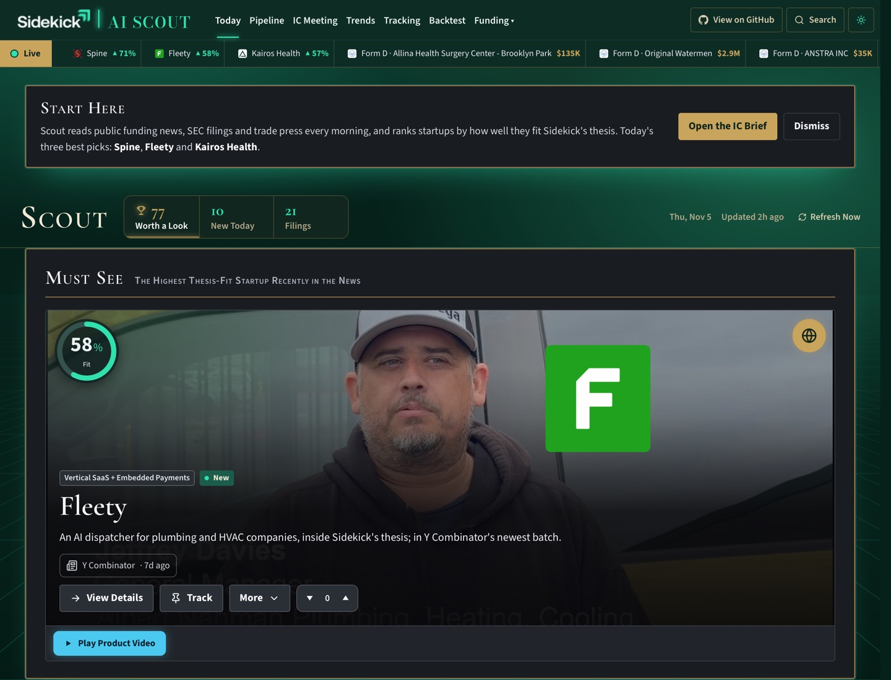

# 🤝🏾🔭 Sidekick Partners AI Scout


> A prototype of an AI scout optimized for sourcing and tracking Premium Consumer Brands, Consumer Health, E-Commerce Software, Vertical SaaS and Tech-Enabled Roll-Up startups synergistic with Sidekick Partners.

[](LICENSE.txt) [](https://nextjs.org/) [](https://neon.tech/) [](https://vercel.com/)

**VIEW LIVE DEMO →** [sidekick-partners-scout.vercel.app](https://sidekick-partners-scout.vercel.app)

<sub>An independent prototype. Not affiliated with or endorsed by Sidekick Partners.</sub>

---

## ✨ Page Features



- 🎯 **Today** — Your morning coffee read: the one Must See startup, the Shortlist by thesis fit and everything else On the Radar, each with its fit and Funds Raised
- 🗂️ **Pipeline** — Every thesis-friendly startup in one Fit Table, ranked by fit, with a lightweight CRM to move deals from New to Reached Out
- 🗓️ **IC Meeting** — Your Monday partner meeting starter pack, i.e. the week's top startups, trends and fund moves
- 📈 **Trends** — The ideas two or more outlets raised this week, each inside one of Sidekick's five industries
- 🔔 **Tracking** — The companies, trends and people you follow, plus custom alerts, checked every morning
- ⏪ **Backtest** — How many days before the announcement Scout would have had the deal: Seven Sundays 2,660 days early, Crown Affair 868, SafeGuard Privacy 709
- 💵 **Filings** — Fresh SEC Form D and Form C filings inside the thesis, flagged when no press has covered them yet, with Holdings and Group filers tagged as possible roll-up vehicles
- 🏘️ **Co-Investors** — A timeline of what Sidekick's 49 co-investors (M13, QED Investors, Nyca Partners …) just backed, i.e. hear about the next shared deal early
- 🤝🏾 **Synergistic Funds** — 29 funds with a Sidekick-style thesis that back all five industries, and who they're backing now
- 📝 **Draft the Memo** — On any startup: a first investment memo that states only what Scout found, each data point linked, every gap a question for the founder
- 🏦 **Likely Acquirers** — The buyers and comps in each startup's industry, flagged Buyer Already Invested when a buyer's venture arm is on the cap table

---

## 🗓️ What Runs Each Day

| **Job** | **When** |
| ------- | -------- |
| Co-investor watch | 1 AM ET |
| Synergistic Funds watch | 2 AM ET |
| The people Scout tracks | 3 AM ET |
| Startup signals: SEC Form D and Form C, Y Combinator, Hacker News, GitHub, App Store charts, funding and trade news | 4 AM ET |
| Scoring, "why it fits", portfolio check | 5 AM ET |
| Alerts | 6 AM ET |
| Trends | 8 AM ET |
| Funds Raised, websites and pictures, the startup filter, the AI Thesis Check | 10 AM ET |
| News links opened to the outlet's own page | 11 AM ET |
| The Monday brief | Sundays, 11 PM ET |
| Weekly upkeep: the portfolio from Sidekick's own page, link checks, the backtest of Sidekick's deals | Sundays, 1 AM ET |

<sub>Times in Eastern Standard Time; each runs an hour later in summer.</sub>

---

## 💡 Usage Examples

Customize via **Settings** on the site and or ask your agent — Scout has you covered either way!

### Tune what Scout reads

```
"Turn off a source"
```

Or switch it off in **Settings › Sources**, which also shows how often each source has proved a round.

### Change how picks are ranked

```
"Change the scoring weights"
```

Or move a slider in **Settings › Scoring**: the other weights rebalance to keep 100.

### Add a news feed

```
"Add this trade publication's feed to Scout"
```

Or follow one company, trend or person with **Track** on its card; Tracking checks it every morning.

The agent will:

- Find the setting or rule behind the request
- Make the change and run the checks
- Redeploy so the live site picks it up

---

## 🤖 AI Inside

| **Feature** | **Model** | **What it does** |
| ----------- | --------- | ---------------- |
| 🧪 AI Thesis Check | GPT-5 mini (OpenAI) | Reads every new startup and says whether it sits inside Sidekick's thesis, and why |
| 📝 Draft the Memo | GPT-5 (OpenAI) | Writes the first investment memo from what Scout found, up to 4 a day |
| ✅ Daily on/off check | Gemini 2.5 Flash-Lite (Google) | Confirms the AI answers before the jobs lean on it |

---

## ⚠️ Prototype Limits

- **Once a day** — Each job runs once a day (Vercel Hobby); Refresh Now pulls fresh news any time
- **Proof needs a report** — A round counts only when a news story or the startup's own page names it; Crunchbase and PitchBook block scripts, so 73 of Sidekick's 86 deals still wait for one
- **Trends need two outlets** — A trend shows only when two independent outlets raised it, so Trends hides itself on a quiet week
- **Links only** — X, Instagram, LinkedIn and PitchBook are links only

---

## 🚀 Installation

Sidekick's Scout on your own free Vercel account. **Nothing to set up in advance:** if you need a Vercel account, the sign-in page creates a free one.

### ⌨️ Run It Yourself

You need a Mac or Linux (Windows through [WSL](https://learn.microsoft.com/windows/wsl/install)), git and [Node.js](https://nodejs.org/) 20 or newer.

```bash
git clone https://github.com/adriangrantdotorg/Sidekick-Partners-AI-Scout.git sidekick-scout
cd sidekick-scout/Engine
npm run launch
```

Six steps, each shown on the progress page that opens and in the terminal:

| **Step** | **What happens** |
| -------- | ---------------- |
| 1. Setup | Opens the Vercel sign-in and the Neon terms page, then installs, links the Vercel project and sets the environment |
| 2. Database | Creates the tables and loads Sidekick's 49 co-investors, 29 Synergistic Funds and 86 portfolio companies |
| 3. Build and Tests | One production build, the unit tests, a real call to each AI feature, then the browser suite on a made-up local Scout |
| 4. Deploy | Uploads the build that was just tested |
| 5. Fill the Site | The first pull, 12 months of funding news, the AI Thesis Check on every card, the Library, the backtest of Sidekick's deals |
| 6. Open | Checks the live site, then opens it |

**The only moments it needs you,** all in the first minutes:

- Signing in to Vercel, and clicking Accept on Neon's terms
- Typing your email for the SEC: its rules ask every filing request for a contact (Return skips the filings; or launch with `SEC_CONTACT_EMAIL=you@example.com npm run launch`)

Then walk away.

**AI features:** Vercel's free AI credit asks for a card on file (nothing is charged on the free credit). Without one, step 3 stops: launch with `LAUNCH_SKIP_AI=1 npm run launch` and the site runs with its AI features off.

**If a step fails,** it prints the way past it. Resume with `npm run launch -- --from <step>`.

### 🔄 Keeping It Current

```bash
npm run update
```

Builds the newest version, deploys it and checks the live site. With an agent, just say "update Scout".

### 🧩 Another Firm

Scout is one shared app (`Engine/`) and one folder per firm, holding its thesis, sources, fund lists, look and copy. Copy `Example Firm/`, fill its `profile.ts` and `brand/`, add it to `FIRMS` in `Engine/firm.config.mjs`, then `NEXT_PUBLIC_SCOUT_FIRM=<its id> npm run launch`.

---
